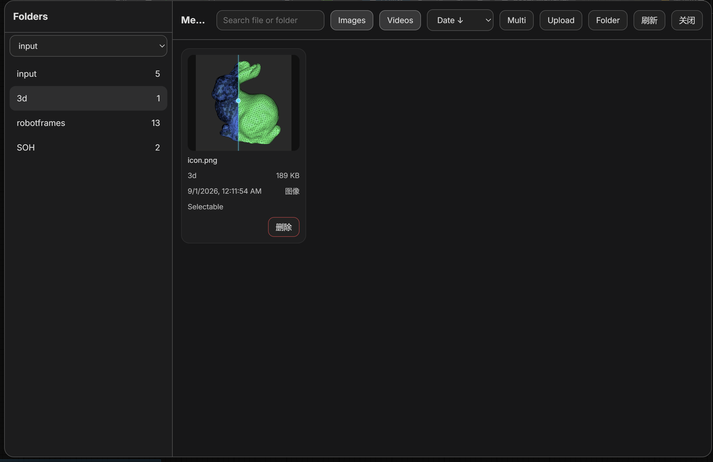

# ComfyUI Load Image Media Browser

**ComfyUI Load Image Media Browser** is an independently published derivative project based on `audioscavenger/ComfyUI-Thumbnails`.

## Screenshots

### Demo Media Browser


### Node Overview


## Features

It adds a media browser to the native **Load Image** and **Load Video** nodes in ComfyUI, making it easier to browse, preview, sort, and select files from the ComfyUI `input` and `output` directories.

## Features

- adds a **Browse Media** button to **Load Image** and **Load Video**
- shows **images and videos in both nodes**
- only compatible media can be selected in each node
  - **Load Image** selects image files
  - **Load Video** selects video files
- **Images** / **Videos** toggle buttons to show or hide media types
- remembers the last opened folder
- keeps next / previous selection inside the current folder
- sorting by:
  - date descending
  - date ascending
  - name A–Z
  - name Z–A
- direct file deletion from the browser (single file, multi-select delete button, and whole-folder delete)
- **Multi** only toggles multi-select mode; the **Delete** button next to it deletes the selected files (stays visible, greyed out when nothing is selected)
- **Folder** dropdown can browse both the `input` and the `output` root, so a rendered image can be picked as input again (the node value becomes `"<file> [output]"`)
- per-card **View** button (left of Delete) opens a **panel-sized preview**: the image fills the browser dialog and `‹` / `›` page through the current batch; the arrows sit outside the image, next to the panel edges, and `←` / `→` / `Esc` work too
- **Upload folder**, **Copy path** and **Delete folder** sit at the bottom of the folders sidebar; *Copy path* copies the absolute path of the selected folder
- write actions (upload / delete) are limited to the `input` root
- after saving an edit in the **Mask Editor** or the **Painter**, the node keeps loading the edited image (annotated `"<file> [input]"` widget values are resolved the same way as the native Load Image node)
- mixed aspect ratio thumbnail support
- automatic node resizing for media previews
- aspect-ratio presets for:
  - `16:9`
  - `9:16`
  - `1:1`
  - `4:3`
  - `3:4`

## Supported media

### Images
`png`, `jpg`, `jpeg`, `webp`, `gif`, `bmp`, `tif`, `tiff`, `avif`, `jxl`, `apng`, `ico`

### Videos
`mp4`, `webm`, `mov`, `m4v`, `mkv`, `avi`

## How it works

This extension enhances the native ComfyUI file-loading workflow.

- **Load Image** and **Load Video** get an additional **Browse Media** button
- the browser opens in the current or last used folder
- both media types remain visible for context
- only valid media for the active node can be selected
- selected media is written back into the native node widget, so the workflow still behaves like a normal ComfyUI workflow

## Installation

### Manual Download

1. Open a terminal inside your `custom_nodes` folder in your ComfyUI installation.
2. Clone this repository into `ComfyUI/custom_nodes/`:

```bash
git clone https://github.com/wardenlee/ComfyUI-Load-Image-Media-Browser.git
```

Then:

1. restart ComfyUI
2. hard refresh the browser once

## Updating

Replace the old folder, restart ComfyUI, and hard refresh the web UI.

## Notes

- videos are previewed in the browser UI and can be selected through **Load Video**
- images are previewed in the browser UI and can be selected through **Load Image**
- this extension works inside the ComfyUI `input` directory structure
- file deletion is limited to files inside the allowed input tree
  
## Thumbnail behavior

- thumbnails are not stored as separate files
- previews are generated directly from the original media in the ComfyUI `input` directory
- this node does not create a persistent thumbnail cache
- closing ComfyUI does not remove any thumbnail files created by this node, because none are created

## Release

Current version: **1.0.2**

## Suggested GitHub topics

`comfyui`, `custom-node`, `media-browser`, `thumbnail-browser`, `load-image`, `load-video`

## Credits

Original upstream project: `audioscavenger/ComfyUI-Thumbnails`

This repository is an independently published derivative work with additional changes, behavior updates, and packaging.

## License

This repository uses **AGPL-3.0-or-later**.

Keep the included `LICENSE` file when redistributing or publishing modified versions.

## Publisher metadata

Suggested `pyproject.toml` values:

```toml
[tool.comfy]
PublisherId = "puk77"
DisplayName = "ComfyUI Load Image Media Browser"
```
